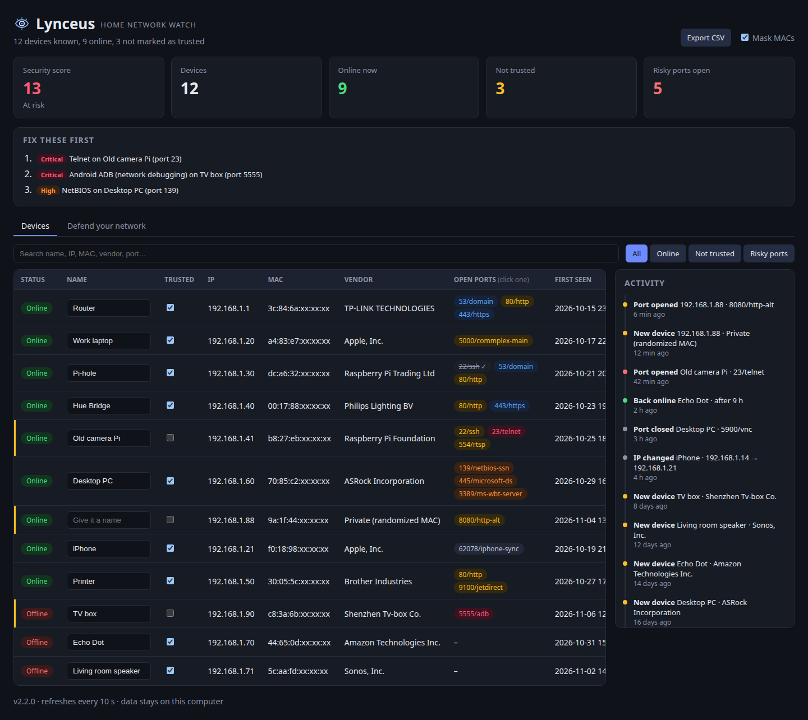
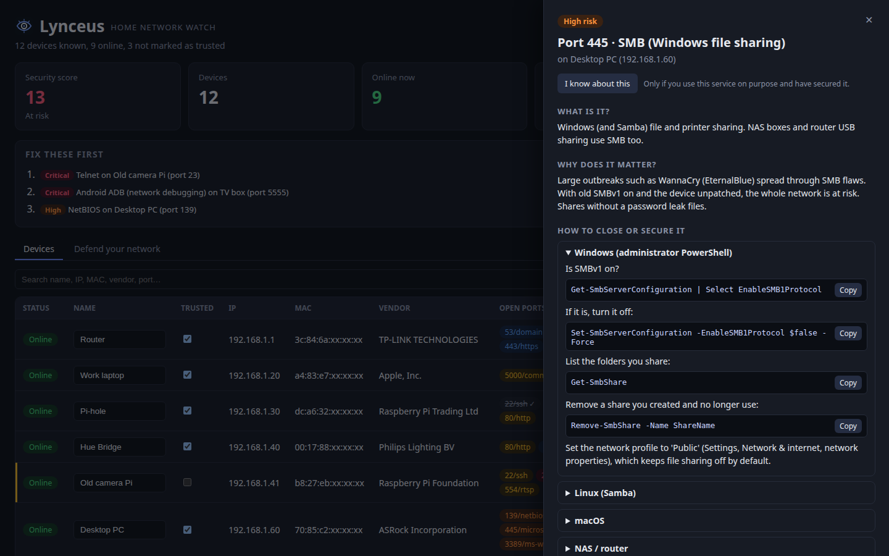
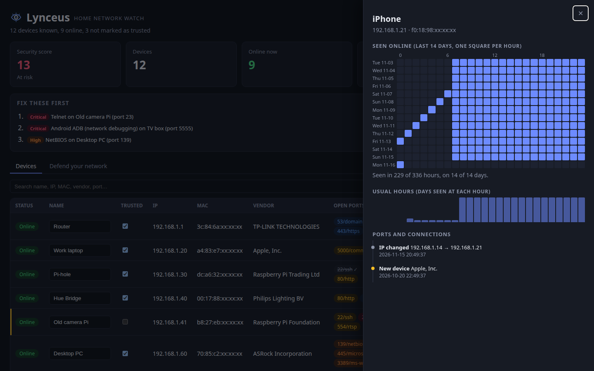
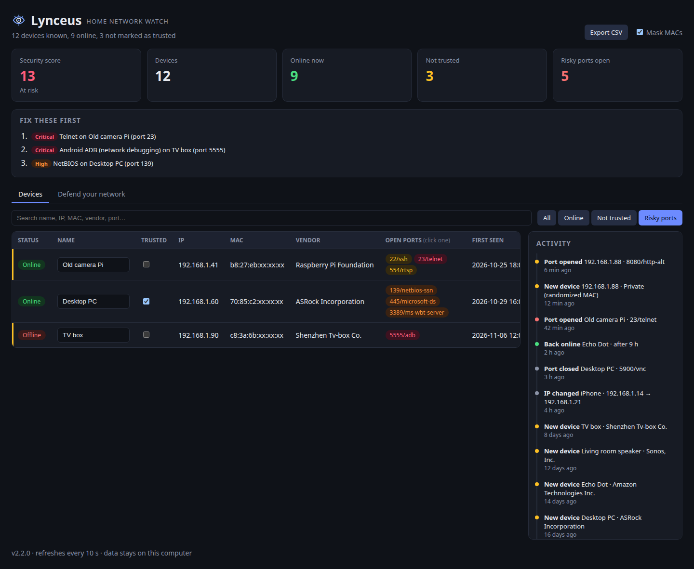
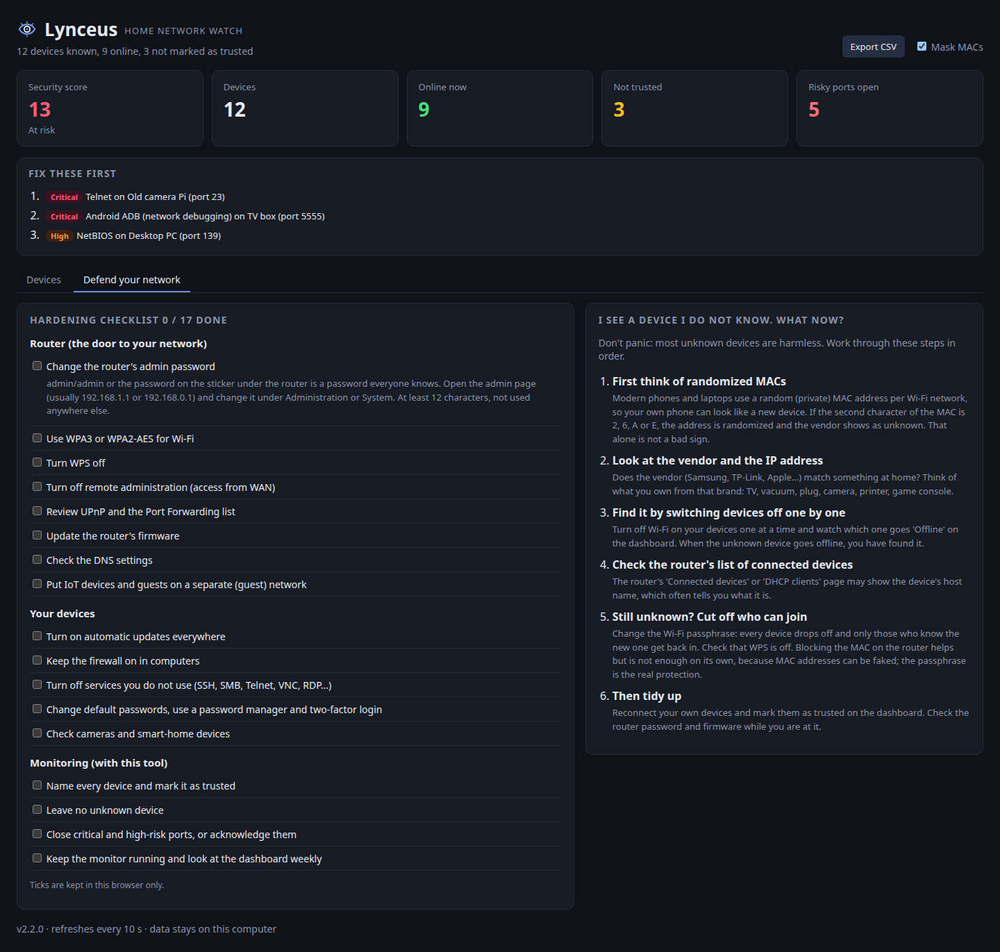
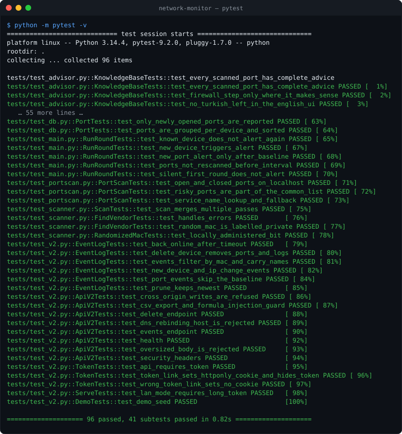
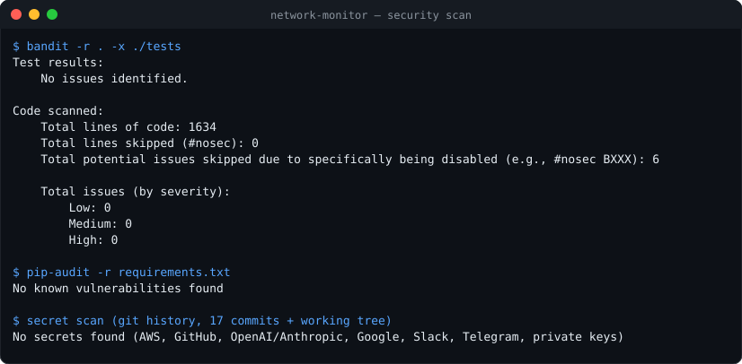

# Lynceus

[](https://github.com/fas0ftware/lynceus/actions/workflows/ci.yml)


A lightweight tool that scans your home network, remembers every device it sees, checks each one for open ports, **alerts you on your desktop or phone** when something new appears, and shows it all in a live dashboard with an **activity timeline**. Since 2.1 it also **tells you what to do**: every open port has a risk level, an explanation and step-by-step instructions to close it, and the network gets a **security score**.

Named after Lynceus, the Argonaut lookout whose eyes could see through walls and even into the earth: nothing on your network stays hidden from it. (Called *network-monitor* before 2.2.)

Built with Python, Scapy, SQLite, Flask and vanilla JavaScript – no build step, no cloud, data stays on your machine.



## Why this project

Most people have no idea what is connected to their Wi-Fi. This tool answers:

- Which devices are on my network right now, and which of them do I actually trust?
- Did something new just connect? Did a device change its IP or come back after days?
- Did a device suddenly open a new, possibly risky port (Telnet, SMB, RDP, VNC…)?
- And then: **what is that port, and how do I close it?**

## Features

**Discovery & inventory**
- **ARP scan** with Scapy; several passes are merged so sleeping devices are less likely to be missed.
- **Vendor lookup** from the MAC prefix; **randomized private MACs** (phones' per-network addresses) are recognised and labelled.
- **Persistent inventory** in SQLite keyed by MAC, with first/last seen, friendly name and trusted flag.

**Exposure checks**
- **Port scan** of 29 common TCP ports per device (rescanned at most every 30 min), including ADB, the Docker API, Redis, MongoDB, MySQL, PostgreSQL, NFS, CUPS and MQTT.

**Security advisor (v2.1)**
- Every port has a **risk level** (info, low, medium, high, critical) and a colour on the dashboard.
- Click a port: a side panel says **what it is, why it matters, and how to close or secure it**, per platform (Linux, Windows, macOS, router/camera/IoT), with copyable commands already filled in with the device's address, and how to **check it is closed** (`nc -zv`).
- **Security score** (0–100) and a **"Fix these first"** list of the three worst open ports.
- **"I know about this":** acknowledge a port you run on purpose (your own SSH server); it stays listed, struck through, and stops lowering the score.
- **"Defend your network" tab:** a 17-step hardening checklist (router, devices, monitoring; ticks kept in your browser) and a playbook for *"I see a device I do not know"*.



**Alerts**
- New device, new open port – in the terminal, as a **desktop notification**, and optionally as a **phone push** via [ntfy](https://ntfy.sh) or a **Discord / Slack / Mattermost webhook**.
- The first run is silent (your existing devices become the baseline); port alerts start after a device's baseline scan.

**Dashboard**
- Summary cards (devices, online, not trusted, risky ports), search, quick filters.
- **Activity timeline:** new devices, IP changes, devices back online after a while, ports opened/closed, devices removed.
- Name / trust / **forget** a device, **CSV export**, MAC masking for screenshots (`?mask=1`).
- **Device history:** *History* on any row shows the hours it was seen online over the last 14 days, its usual hours, and its port and connection events (link straight to one with `/#history=<mac>`).

**Security hardening (v2)**
- Listens on `127.0.0.1` by default. Serving on the LAN **requires a token** (16+ characters), exchanged once for an `HttpOnly`, `SameSite=Strict` cookie.
- **DNS-rebinding protection** (trusted `Host` headers) and **CSRF protection** (cross-origin writes refused).
- Strict **Content-Security-Policy** (no inline script), `X-Frame-Options: DENY`, `nosniff`, `no-referrer`, `no-store` on API responses, 16 KB request limit.
- Untrusted text is rendered with `textContent` only; CSV export is protected against spreadsheet formula injection.
- Parameterized SQL everywhere; notification commands are argument lists (no shell) and use `--` so a vendor name can never become an option.



<p align="center"> </p>

## How it works

```
 scanner.py ─┐
 (ARP scan)  │
             ├──► main.py ──► db.py ──► devices.db (devices, ports, events, accepted_ports)
 portscan.py ┘   (loop +     (SQLite)        ▲
 (TCP ports)      alerts)                    │
                     │                       │
                  alert.py                app.py ──► templates/ + static/
        (desktop, ntfy, webhooks)     (Flask API)      (dashboard)
                                             │
                     advisor.py (port knowledge base, score) + defense_guide.py (checklist, playbook)
```

**Score:** every open port you have not acknowledged adds penalty points by risk
(low 2, medium 6, high 14, critical 25), every untrusted device 4 (at most 20).
The score is `100 × e^(−points/80)`, so the first problems cost the most and the
number keeps moving as you fix things. One open critical port caps it at 39, a
high one at 69: a network with Telnet open is never "Good".

A device counts as **online** if it was seen in the last 3 minutes.

## Installation

Requirements: Linux, Python 3.10+, root or `CAP_NET_RAW` for the scanner (raw ARP packets), optionally `notify-send` (`libnotify`). Or Docker (below).

```bash
git clone https://github.com/fas0ftware/lynceus.git
cd lynceus
python3 -m venv venv && source venv/bin/activate
pip install -r requirements.txt
```

### What answers on a port (Janus)

With the [Janus](https://github.com/fas0ftware/janus) scanner installed (the Docker
image includes it), port checks run `janus --sv` and record what actually answers, not
what the port number usually means: `OpenSSH 9.6p1` on 2222, a web server on 8080, or
`TLS 1.0, AES256-SHA` on a TV's 8080 (an outdated cipher the number alone would never
show). The software line appears when you hover a port on the dashboard. Without Janus,
or if it fails, the built-in connect scan is used; start-up says which one runs.

### Docker

```bash
cp .env.example .env        # LYNCEUS_IP_RANGE, push URLs, dashboard address
docker compose up -d        # scanner + dashboard, data in the lynceus-data volume
```

The dashboard is then at `http://127.0.0.1:5000` on the host. Both containers use the
host network (ARP only works there) and run as an unprivileged user with a read-only
file system:

- **scanner**: every capability dropped except `CAP_NET_RAW`. Instead of root, only a
  copy of the Python interpreter that the scanner alone uses carries that one file
  capability; without it the scanner cannot start.
- **dashboard**: no capabilities at all and `no-new-privileges`.

CI builds the image and checks both: raw packets only with `NET_RAW` as uid 10001, and
the dashboard answering with everything dropped. Desktop notifications do not reach a
container; use `LYNCEUS_NTFY_URL` or `LYNCEUS_WEBHOOK_URL` there.

## Usage

Try the dashboard without scanning anything:

```bash
python app.py --demo          # throw-away database with sample devices
```

Real use – the scanner in one terminal, the dashboard in another:

```bash
sudo venv/bin/python main.py --range 192.168.1.0/24 --interval 60
python app.py                 # http://127.0.0.1:5000
```

Find your subnet with `ip -4 -brief a` (`192.168.1.23/24` → `192.168.1.0/24`). Ranges larger than `/20` and IPv6 are refused. `main.py --once` scans a single round.

### Configuration (`.env` / environment)

| Variable | Default | Meaning |
|---|---|---|
| `LYNCEUS_IP_RANGE` | `192.168.1.0/24` | Subnet to scan |
| `LYNCEUS_DB` | `devices.db` | SQLite file (read by both programs) |
| `LYNCEUS_NTFY_URL` | – | e.g. `https://ntfy.sh/<long-random-topic>` for phone push |
| `LYNCEUS_WEBHOOK_URL` | – | Discord / Slack / Mattermost incoming webhook |
| `LYNCEUS_HOST` / `LYNCEUS_PORT` | `127.0.0.1` / `5000` | Dashboard address |
| `LYNCEUS_TOKEN` | – | Required (16+ chars) when `LYNCEUS_HOST` is not loopback |
| `LYNCEUS_JANUS` | auto | Path to the [Janus](https://github.com/fas0ftware/janus) scanner (else `janus` on `PATH`, else `../Janus/janus`) |
| `LYNCEUS_ENGINE` | `auto` | `builtin` = never use Janus, only the connect scan |

The old `NETMON_*` names from before 2.2 still work; a `LYNCEUS_*` setting wins when both are set.

To open the dashboard on your phone: set `LYNCEUS_HOST=0.0.0.0` and a token (`python -c "import secrets; print(secrets.token_urlsafe(24))"`), then visit `http://<pc-ip>:5000/?token=<token>` once.

### API

| Method | Endpoint | Description |
|---|---|---|
| `GET` | `/api/devices` | All devices with status, name, trust flag and open ports (`name`, `risk`, `risky`, `accepted` each) |
| `POST` | `/api/devices/<mac>` | `{"name": "Laptop", "trusted": true}` |
| `DELETE` | `/api/devices/<mac>` | Forget a device (it is reported as new if it returns) |
| `GET` | `/api/events?limit=100&mac=…` | Activity log, newest first (port events carry `risk`) |
| `GET` | `/api/devices/<mac>/history?days=14` | Hours seen online per day (up to 30 days), seen-per-hour totals, the device's events |
| `GET` | `/api/summary` | Security score, label, counts per risk, top three actions |
| `GET` | `/api/advice/<port>?service=…` | What the port is, why it matters, fix steps per platform, how to verify |
| `POST` | `/api/devices/<mac>/ports/<port>/accept` | `{"accepted": true}` acknowledges an open port (`false` undoes it) |
| `GET` | `/api/defense-guide` | Hardening checklist and the unknown-device playbook |
| `GET` | `/api/devices.csv` | Inventory as CSV |
| `GET` | `/api/health` | `{"ok": true, "version": …}` |

## Tests

103 tests (plus subtests) – the advisor (every scanned port has complete advice, score, caps, acknowledged ports, its API and token protection), database and migrations, event log, online-hours history, API, security headers, DNS-rebinding and CSRF guards, token flow, CSV injection guard, port scanner on local sockets, alerts and webhooks (mocked), the scan loop with fake network data, demo data. No root, no network.

```bash
pip install -r requirements-dev.txt
python -m pytest -v
```



## Security scan

CI runs [bandit](https://github.com/PyCQA/bandit) and [pip-audit](https://github.com/pypa/pip-audit) on every push. Latest local scan, including a secret scan of the full git history:



**Scan only networks you own or are authorized to test.** Port scanning other people's networks may be illegal.

## Known limitations

- **Randomized MACs:** a phone may appear as a new device when it rotates its private address (it is labelled as such).
- **Sleeping devices** can briefly show as offline; **client isolation** on the router hides devices from each other.
- Only a fixed list of common **TCP** ports is checked; UDP is not scanned.
- Desktop notifications are Linux-only (`notify-send`); push webhooks work everywhere.

## Changelog

- **2.6.1** – Security: desktop notifications escape `&`, `<` and `>` in the text. A device on the network chooses its own name and banners, and notification servers read the body as markup, so a name like `<a href=…>` could add a link to an alert.
- **2.6.0** – Per-device history: every scan marks the hour a device was seen (one row per device per hour, kept 30 days, removed when you forget the device). The *History* panel shows a 14-day hour grid, the usual hours and the device's events. The demo has two weeks of hours.

- **2.5.0** – Trusted devices no longer push alerts for ordinary new ports (the event log still records them). Risky ports (high and critical, e.g. Telnet, SMB, an open database) on a trusted device still alert: that is when you most want to know.

- **2.4.0** – Port checks with [Janus](https://github.com/fas0ftware/janus) when it is installed (and in the Docker image): what really answers on each port, stored in a new `version` column (older databases get it on start) and shown on the dashboard. Falls back to the built-in scan when Janus is missing or fails.

- **2.3.0** – Docker image and `compose.yaml` (scanner with only `CAP_NET_RAW` as a normal user, dashboard with no capabilities). The scanner now asks the kernel whether it may send raw packets instead of insisting on root, so it also runs with just that capability outside Docker.

- **2.2.0** – new name: **Lynceus** (was network-monitor). Settings are `LYNCEUS_*`; the old `NETMON_*` names keep working. The dashboard login cookie was renamed, so a phone that used the token link opens it once more.

- **2.1.0** – Security advisor: risk level and fix guide for 29 ports (10 more scanned: ADB, Docker API, Redis, MongoDB, MySQL, PostgreSQL, NFS, rpcbind, CUPS, Telnet on 2323), side panel with copyable commands, security score and "Fix these first", acknowledge ports ("I know about this"), "Defend your network" tab with checklist and unknown-device playbook. Risky ports and alerts now follow the advisor's levels (high and critical). Ported from the 2.0-era `security-advisor` branch and translated to English.
- **2.0.0** – Activity timeline (new device, IP change, back online, port opened/closed, removed), ntfy + Discord/Slack webhooks, forget device, CSV export, summary cards, search and filters, randomized-MAC detection, `--once`, `--demo`; security hardening (token for LAN mode, DNS-rebinding and CSRF guards, CSP and security headers, request size limit, CSV formula guard); English UI; pytest suite; CI security scans.
- **1.0.0** – ARP inventory, port checks, desktop alerts, dashboard with names and trust flags.

## Roadmap

- [x] Docker image (2.3)
- [x] Use the trusted flag to mute port alerts for chosen devices (2.5; risky ports still alert)
- [x] Detect what actually answers on a port instead of trusting the port number (2.4, with Janus)
- [x] Per-device history chart (2.6)
- [ ] Weekly report: new devices, ports opened, devices that changed habits

---

Python · Scapy · SQLite · Flask · JavaScript · HTML/CSS — Part of the **FA Software** projects. Licensed under the [MIT License](LICENSE).
